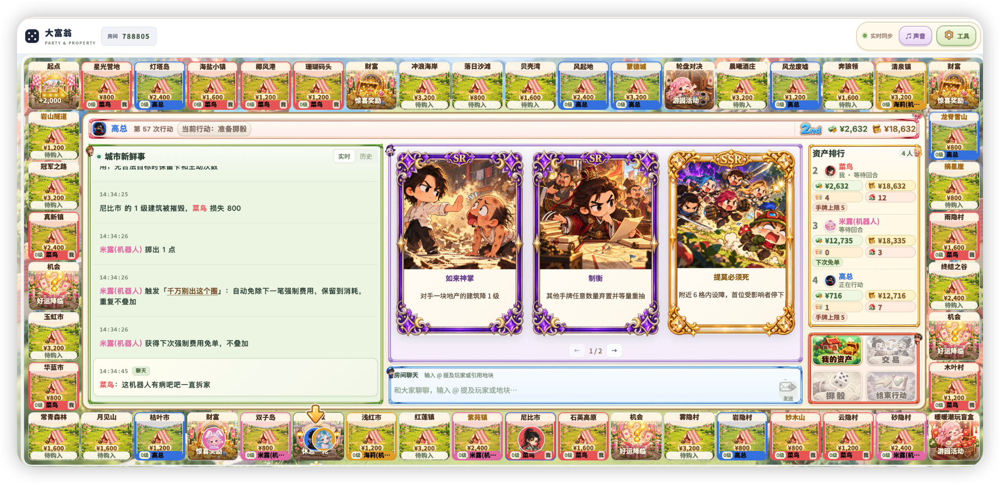
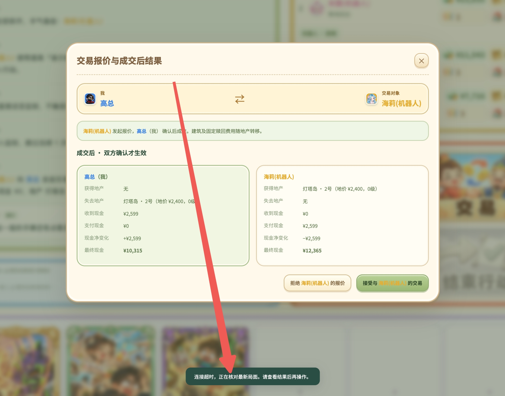

# 大富翁·奇迹大陆

和朋友一起掷骰、买地、建房，也用一手意想不到的卡牌改变局势。在熟悉的大富翁玩法里，加入玩家交易、机会与财富事件，以及不断轮换的九种小游戏。

**在线开玩：[https://dfw.njyayu.cn/](https://dfw.njyayu.cn/)**

支持 **2～6 人**，电脑和手机都能通过浏览器参与。用房间号邀请朋友，也可以添加机器人补位，或打开观战页面投屏看整场对局。

## 游戏画面

棋盘、手牌、城市新鲜事和资产排行集中展示，随时查看当前行动、地产归属和局势变化。

## 一起开一局

1. 打开[线上地址](https://dfw.njyayu.cn/)，选择「创建房间」。
2. 把六位房间号发给朋友，其他人在首页选择「加入房间」。
3. 房主选择小、中、大地图；需要时添加机器人，选择难度。
4. 玩家准备完成后，由房主开始对局。

只想看热闹，可以选择「投屏观战」，输入房间号查看公开局面。聚会时也可以用大屏展示棋盘，大家在自己的设备上操作。

## 每回合怎么玩

**掷骰前决定是否出牌 → 掷骰移动 → 处理落点 → 管理资产或交易 → 结束行动。**

- **先出牌，再掷骰。** 普通主动卡牌通常每回合最多使用一张，防御和响应卡按弹窗提示使用。
- **停在无主地产：** 可以购买，也可以放弃。
- **停在自己的地产：** 未抵押且未满级时，可以付费升一级，最高三级；刚买下的地产本次不能立即建房。
- **停在别人的地产：** 按当前租金结算，建筑等级越高，通常收费越高。
- **停在机会或财富格：** 立即触发事件，可能获得现金、道具，也可能遇到费用、位移或建筑变化。
- **停在活动角：** 开启当前小游戏，参与范围和奖励以当场提示为准。
- **处理完当前待办后：** 可以管理资产、协商交易，最后点击「结束行动」。

正向经过或最终停在起点，可以领取现金与卡牌补给。后退途中经过起点不领奖，后退最终停在起点可领奖一次；特殊移动按对应提示处理。

## 买地收租，也要留好现金

买下地产后，通过再次踩中升级，逐步提高租金收入。地产多、建筑高，收入机会也更多，但现金全部花光时，一次高额租金就可能让局势反转。

需要筹款时，可以卖房、抵押或整套出售地产。抵押后保留建筑，但暂停收租，之后可以支付赎回费恢复经营。遇到强制费用时，先处理可用的防御选择，再按提示筹款并确认付款。

**资产榜展示当前排名，最终胜利属于最后一名未破产的玩家。** 无力偿债时按提示进行破产清算，退出竞争后仍可继续观战。

## 卡牌让局势多一点意外

手牌里有移动、建筑、现金、干扰与防御等不同效果，也有熟悉的角色、名场面和梗。

- 调整移动和落点，争取买地、升级或避开高额租金。
- 影响其他玩家的位置、建筑或手牌，打乱对方的计划。
- 在费用或攻击弹窗中使用合适的防御卡，保住现金与资产。
- 默认手牌上限为六张，补给超限时选择保留，其余按提示折现；部分效果会改变上限。

卡牌的具体效果、目标和使用时机，以卡面说明和当前提示为准。自己的手牌只有自己可见。

## 和朋友谈一笔交易

现金、地产都可以放进报价里，买卖、交换或补差价，由双方协商。对方接受后才会成交，建筑和抵押状态随地产一起转移。

欠其他玩家费用时，也可以协商用地产抵债，或者向第三人出售资产筹款。报价窗口会列出双方获得与失去的地产、现金变化和成交后的结果，确认合适再接受。

## 九种轮换小游戏

起点和监狱固定，另外两个角会定期更换游戏。**九种游戏等权洗牌排队，每期两个，相邻两期不会重复出现同一个游戏。**

| 游戏 | 怎么玩 |
| --- | --- |
| 暖暖赌场 | 踩中者自愿下注，猜大小或猜一个点数，也可以放弃。 |
| 小镇赛马 | 大家自愿下注，从八匹马中选冠军，可以押同一匹。 |
| 轮盘对决 | 踩中者可放弃，或指定一名对手展开轮盘对决，败者承担费用。 |
| 拼手气红包 | 全场未破产玩家各选一个红包，领取随机金额，还有机会幸运翻倍。 |
| 猜拳擂台 | 大家秘密出拳，逐轮淘汰，最后一人独得奖金。 |
| 贪心宝箱 | 付出本金逐层二选一，可以见好就收，也可以冒险冲击三层大奖。 |
| 三关玻璃桥 | 自愿参加，连续三关秘密选左右，全部通过者获得奖励。 |
| 少数派夜市 | 秘密选择火锅摊或烧烤摊，人数较少的一边抽取一名中奖者；平局或同摊则全员抽取。 |
| 暖暖潮玩盲盒 | 免费选盒，寻找隐藏款，还有机会开出双倍限定款。 |

每隔「开局人数 × 5」个已结束的个人回合轮换一期，最后三个回合会预告下一期。游戏按排上棋盘计数，没有踩到也会正常轮换；经过活动角不触发，停下才参加。部分活动获胜或达成条件后，还会额外获得一张随机道具。

## 暂时离开，下次接着玩

- **断线重连：** 使用同一浏览器刷新，或重新输入房间号，可以恢复原座位，请保留浏览器数据。
- **等待朋友：** 轮到离线玩家处理行动、选择或报价时，会等待重连；房主也可以移出离线玩家。
- **保存进度：** 对局进度自动保存，房间中的「存档」可以标记当前保存点并添加备注。
- **回顾与恢复：** 从首页「历史与恢复」或房间「历史回顾」查看记录；保留固定存档码，可以从可恢复的保存点另开房间，由房主分配保存角色后继续。

邀请朋友来一局，先攒地产，还是先攒一手翻盘牌，都由你决定。
