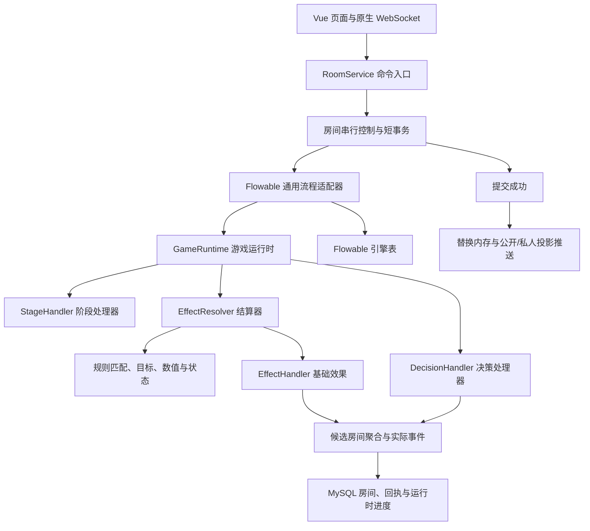
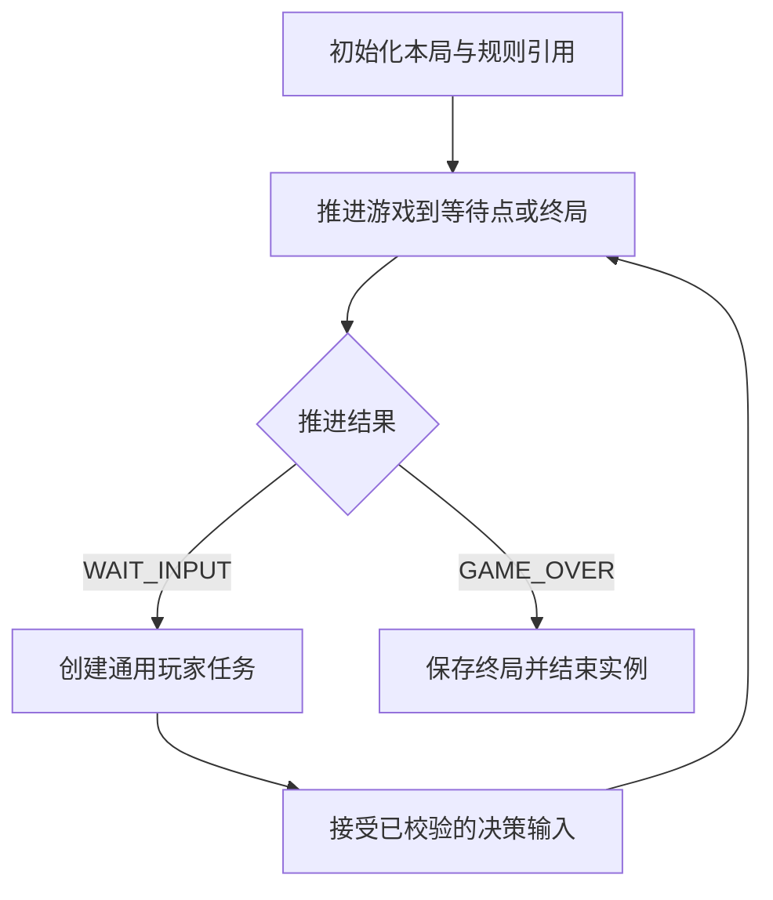

# 大富翁可配置规则与效果结算架构设计

日期：2026-10-12。状态：通用流程、效果队列、配置回合阶段和六种道具的最小 DSL 已接入；完整表达式、执行帧、持续状态和新增全图效果仍为设计。实际可加载格式见 [回合阶段与道具规则配置](game-rules-dsl.md)，下文完整设计的 JSON 示例不能直接作为当前规则包使用。

本文采用一个稳定的 Flowable 通用流程，配合可配置回合阶段、可组合效果和 Java 处理器。新增卡牌、全图事件或阶段配置，原则上不修改 BPMN；只有通用等待协议或运行时生命周期发生变化时，才评估流程升级。

### 本次已落地范围

- 使用 `flowable-spring:8.0.0` 嵌入 BPMN 引擎，复用 Spring Boot 4.1.1 的数据源和显式共享事务管理器。部署 `processes/generic-game-runtime.bpmn20.xml`，一局一个实例，一个通用玩家任务循环。
- 新开局的 `Room.runtime` 保存实例、任务、选择上下文、规则版本、文件摘要、阶段游标、掷骰结果、有序效果及已结算数量。默认新局绑定 `classic-v2`，已有 `classic-v1` 对局保留原路径。旧快照缺失运行时时继续原引擎，不把旧局的待选事项强行迁移。
- `MOVE`、`SETTLE_TILE`、`PAY_FEE`、`PLACE_BARRIER`、`DEMOLISH`、`SWAP_POSITION`、`WAIVE_RENT`、`OPEN_TRADE`、`ACCEPT_TRADE`、`CLOSE_TRADE` 已有处理器。遥控骰子和停留组合移动与落点，随机事件引发的移动以子效果插入，先完成联动再执行后续效果。
- 新局从 `classic-v2.json` 加载阶段序列及六种道具的发动窗口、主动次数、条件 AST 和基础效果组合，启动校验并按版本复用不可变对象。新增 `REPLACE_ROLL` 和 `LOG` 原语；遥控骰子和停留只设置替代结果，由阶段统一移动和落点。
- 道具合法性、次数、买地、升级、免租、偿债、清算、路障经过判定、交易身份与 60 秒暂停计时保留现有规则。输入仍使用原命令与 `expectedVersion`，服务端内部以 `decisionKey` 关联通用任务，不要求前端增加 `decisionId`。
- 流程推进、效果、快照和回执在同一短事务中提交，发布在事务结束之后。在线变化、服刑跳过、交易超时及房主管理导致选择变化时，同步推进通用任务。启动批量校验任务与房间关联，不在房间循环内查询数据库。
- 当前 Delegate 同步运行，不启用异步游戏推进；流程变量只保存引用和路由标量，历史级别为 `none`，公开记录仍来自房间日志。复杂多目标中途等待、执行帧、通用被动事件总线及规则热发布未实现，不能把下文设计目录当作已有能力。

当前验证：跳过测试的后端编译、前后端类型检查通过；独立临时 MySQL 库完成引擎建表、BPMN 部署和原 HTTP/WebSocket 的新开局、交易接受/取消、路障、买地、换回合查看。服务重启后恢复原任务并继续交易；交易对象断线冻结倒计时，重新连接后继续。在临时库短暂拒绝房间 UPDATE 后，版本、效果计数和 Flowable 任务保持原值，移除拒绝后可继续操作。没有编写单元测试或冒烟测试，没有执行前端 build、已有冒烟脚本或自动提交。本轮另在临时库逐项查看六种道具、次数限制与交易接受；部分道具采用停服后准备的手牌/建筑状态。附加版本在新局执行新增回合开始及掷骰后日志，旧版本对局仍恢复原定义。全部偿债、故障及配置组合尚未逐项验收。

## 1. 目标、范围与当前基线

### 1.1 设计目标

- 支持回合前、掷骰前后、逐格移动、落点、主动行动和回合结束等阶段。
- 保留主动交易、主动道具、购买、升级、免租选择与偿债。
- 路障等陷阱提前放置，满足条件后自动判定；不支持其他玩家途中临时出牌及反制链。
- 支持全体玩家资金变化、全体分别判定、持续化身状态、陷阱免疫、指定地产建筑摧毁和随机补偿。
- 结算需要玩家输入时可以暂停，断线或重启后继续；重复命令不重复消耗、抽样或支付。
- 服务端保留随机结果、资产与胜负的权威，继续隔离公开状态、手牌及私人报价。

### 1.2 实施前已核对的项目基线

以下是设计开始时核对的基线；当前接入情况以文首落地范围为准，后续章节仍描述完整目标设计：

| 当前事实 | 来源 |
| --- | --- |
| Spring Boot 4.1.1、Java 21、Spring JDBC、MySQL Connector/J、Lombok；没有 Flowable 依赖 | `backend/pom.xml` |
| 原生 WebSocket，Vue 前端，命令携带 ID 和预期版本 | `docs/realtime-protocol.md`、`RoomService` |
| 单实例，同房间使用 `ReentrantLock`；不同房间独立 | `application/RoomService.java` |
| 修改候选快照，Repository 事务保存快照与回执，成功后替换内存并推送 | `RoomService`、`MysqlRoomRepository` |
| MySQL 保存 `rooms`、`sessions`、`receipts`，房间内部状态为 JSON | `infrastructure/MysqlRoomRepository.java` |
| 回合、经济、道具和交易为固定 Java 领域服务 | `domain/TurnService.java`、`EconomyService.java`、`ItemService.java`、`TradeService.java` |
| 现有六种道具为遥控骰子、路障、停留、免租、拆房、换位 | `domain/Rules.java`、`ItemService.java` |

当前分层说明见 [Spring Boot 后端分层说明](backend-architecture.md)，协议见 [原生 WebSocket 联机协议](realtime-protocol.md)。历史迁移验证不能作为本次 Flowable 接入的运行证据。

### 1.3 不在首期范围

多人同时秘密选择、临时陷阱响应、反制再反制、任意用户脚本、通用 BPMN 编辑平台、多实例房间协调、完整事件溯源均不纳入首期。具体数值、卡牌平衡和新玩法使用限制也不由架构自行决定。

## 2. 核心决策

| 决策 | 设计 |
| --- | --- |
| 流程实例粒度 | 一局一个主流程实例，业务关联使用 `gameId`；同房间再开创建新实例 |
| Flowable 职责 | 通用等待、任务关联、流程恢复和流程历史 |
| 游戏运行时职责 | 阶段推进、效果解释、被动触发、选择与结算游标 |
| 回合阶段 | 来自本局固定规则集，不为每个阶段新增 BPMN 节点 |
| 新卡牌 | 优先组合已有基础效果；新能力增加 Java 处理器 |
| 结算结构 | 有序工作项和可持久化的执行帧，不实现玩家反制栈 |
| 持久化 | 房间聚合保存游戏权威数据与运行时进度；Flowable 保存通用执行位置 |
| 事务 | Flowable、房间状态与命令回执参加同一数据源、同一事务管理器的短事务 |
| 并发 | 首期复用单实例房间锁；所有玩家、连接和系统写操作遵循该边界 |
| 随机 | 服务端统一生成，已提交的随机样本保存于结算进度，不因恢复重新生成 |
| 规则版本 | 开局固定规则集、流程定义和处理器兼容版本；进行中对局不跟随热更新 |

不把游戏数据复制成第二份可独立修改的流程变量，不给每位玩家或每种被动效果单独启动一个自由写房间的流程。

## 3. 总体分层与职责



| 模块 | 职责 | 禁止承担的职责 |
| --- | --- | --- |
| `RoomService` | 认证、权限、房间锁、命令去重、版本、事务和提交后发布 | 不内嵌 SQL，不枚举所有卡牌 |
| `GameWorkflowAdapter` | 启动实例、完成通用任务、关联决策、提供流程标量 | 不计算租金、建筑损失或卡牌条件 |
| `GameRuntime` | 按配置推进阶段，执行输入，运行到等待或结束 | 不维护第二份现金、手牌或产权 |
| `StageHandler` | 自动阶段、行动窗口、移动和落点阶段推进 | 不重复实现基础资金和产权操作 |
| `EffectResolver` | 效果顺序、执行帧、被动触发与暂停继续 | 不将事实事件直接广播为全局 BPMN Signal |
| `EffectHandler` | 验证及执行一种基础能力，返回实际结果 | 不自行提交事务、查询每个目标或推送网络消息 |
| `DecisionHandler` | 合法选项、输入校验、消费选择和恢复游标 | 不信任客户端金额、玩家身份和流程变量 |
| `RuleSetRegistry` | 校验、加载和按版本解析规则定义 | 不将新版本替换到已有对局 |
| `RoomRepository` / `StatePublisher` | 业务数据存储、白名单投影与投递 | 不直接暴露内部聚合或引擎任务 |

领域服务保持不依赖 Spring、Flowable、WebSocket 或数据库。Flowable Delegate 放在适配层，并保持无状态；不能在 Spring 单例字段里保存当前房间、玩家或执行游标。

## 4. 稳定的 Flowable 通用流程



Flowable 的自动节点调用 `GameRuntime.advanceUntilWait`。该方法在候选聚合中执行一批自动工作，直到出现有效待选事项或终局。自动节点不按每格移动、每个玩家扣款拆成 BPMN 节点。

### 4.1 推进与任务契约

- `WAIT_INPUT`：已准备好一个完整待选事项，包含决策人、类型、关联执行帧及返回位置。
- `GAME_OVER`：没有需要继续的游戏结算，胜负和终局已确定。
- 处理器内部可返回继续、当前效果完成、当前阶段完成；这些状态由运行时消费，不扩大成新的 BPMN 分支。
- 每局最多有一个允许推进游戏的有效决策；首期不创建多人并行决策。
- 一个通用任务可以等待行动菜单、目标选择、买地、免租、偿债或交易回应。
- Flowable 任务 ID 只用于服务端关联。客户端提交 `decisionId`，不能选择任意任务或提交任意流程变量。
- 使用任务创建监听器关联 `taskId` 与 `decisionId`；监听器只记录关联，不执行卡牌逻辑或网络推送。

连接、同步、暂停与恢复不必完成当前游戏任务；它们按原决策更新在线和计时状态。需要某玩家输入而该玩家离线时，保持原任务与决策，暂停倒计时。其他玩家的自动被动效果不因持有人离线而失效。

### 4.2 最少的流程变量

只保存 `gameId`、`decisionId`、`decisionPlayerId`、`advanceResult` 等引用及路由标量。阶段、队列、手牌、报价、随机样本和资金以房间聚合为准。输入经应用层校验后按需传递引用；机密 payload 不复制到流程历史。

### 4.3 Flowable 集成边界

当前使用 `flowable-spring:8.0.0` 显式配置嵌入式 Process Engine，仅接入所需 BPMN 能力，不额外开启 REST、IDM 和事件注册引擎。已在 Spring Boot 4.1.1 / Java 21 下完成编译与隔离 MySQL 启动。Flowable 8 的官方版本说明以 Spring Framework 7、Spring Boot 4 和 Jackson 3 为基线。[Flowable 8 版本说明](https://github.com/flowable/flowable-engine/releases/tag/flowable-8.0.0)

首期游戏写入节点不启用异步 continuation，不使用并行网关修改同一房间，不让引擎 Job 绕过房间写入入口。Flowable 的默认执行会推进至等待点；参与同一 Spring 事务才能将该段流程推进和业务写入一起回滚。[Spring 事务集成](https://www.flowable.com/open-source/docs/bpmn/ch05-Spring/)

## 5. 可配置回合与行动窗口

### 5.1 阶段定义

以下为完整设计的 JSON DSL 示意，与当前最小实现的字段不同，不可直接加载；实际阶段配置参见 [配置指南](game-rules-dsl.md)。第 11 节定义完整表达式和发布校验边界。

```json
{
  "id": "classic_turn",
  "stages": [
    { "id": "turn_start", "handler": "AUTO_HOOK", "hook": "TURN_START" },
    { "id": "before_roll", "handler": "ACTION_WINDOW", "actions": ["trade", "use_card", "roll"], "exitOn": ["roll", "replace_roll"] },
    { "id": "before_dice", "handler": "AUTO_HOOK", "hook": "BEFORE_DICE" },
    { "id": "dice", "handler": "ROLL" },
    { "id": "after_dice", "handler": "AUTO_HOOK", "hook": "AFTER_DICE" },
    { "id": "movement", "handler": "MOVEMENT" },
    { "id": "landing", "handler": "LANDING" },
    { "id": "manage", "handler": "ACTION_WINDOW", "actions": ["trade", "manage_assets", "end_turn"], "exitOn": ["end_turn"] },
    { "id": "turn_end", "handler": "AUTO_HOOK", "hook": "TURN_END" }
  ]
}
```

该示例保留现有掷骰前主动用卡、落点完成后管理资产和交易的入口。新规则集可以开放其他窗口，但不能因引入架构就自动改变现有允许操作、次数限制、建房条件或权限。

遥控骰子或停留先产生 `replace_roll` 结果：运行时跳过正常随机掷骰，设置指定点数或零移动，再按该卡定义的路径进行移动/落点。卡牌本身不能同时直接结算落点、又让阶段处理器再执行一次。阶段处理器使用保存的行动结果决定跳过或继续。

### 5.2 阶段与操作权

| 上下文 | 用途 |
| --- | --- |
| `TurnContext` | 回合玩家、全局回合编号、个人回合序号、阶段位置和行动计数 |
| `ResolutionContext` | 结算链、执行帧、工作项、已生成事件与触发记录 |
| `DecisionContext` | 当前决策人、合法输入、计时状态、关联帧与返回位置 |

回合属于 A，但 A 触发全图扣款后，可能等待 B 偿债；操作权取决于当前决策，不只取决于回合玩家。公开 `phase` 和 UI 文案是运行时的兼容投影，不作为另一套独立推进引擎。

### 5.3 触发时机与事实事件

| 类型 | 代表名称 | 语义 |
| --- | --- | --- |
| 可修改的判定窗口 | `BEFORE_DICE`、`DICE_RESULT_PENDING`、`BEFORE_PAYMENT`、`BEFORE_BUILDING_CHANGE` | 动作尚未完成，允许适用规则修改或阻止 |
| 阶段触发点 | `TURN_START`、`AFTER_DICE`、`TURN_END` | 到达指定阶段；每次进入都有独立发生编号 |
| 已发生事实 | `DICE_FINALIZED`、`TILE_ENTERED`、`PAYMENT_SETTLED`、`BUILDINGS_DESTROYED`、`TRADE_SETTLED`、`STATUS_EXPIRED` | 记录实际结果，只能据此生成后续效果 |

已经付款后产生的返现是新的资金效果，不能将事实重新改写为未付款。重掷和点数修正发生在 `DICE_FINALIZED` 之前。移动沿途判定必须在下一格推进前完成。

## 6. 效果运行时与可恢复结算

### 6.1 四类对象

| 对象 | 关键字段 |
| --- | --- |
| `EffectDefinition` | 定义 ID/版本、处理器类型、参数、标签、适用条件、目标选择和触发策略 |
| `EffectInstance` | 实例 ID、定义引用、来源、目标、原因、根结算 ID、父事件、已解析参数和状态 |
| `ExecutionFrame` | 帧 ID、父帧、步骤位置、目标序列位置、子工作项、返回位置和局部变量 |
| `EffectResult` | 成功/免疫/取消/无作用、实际金额、实际移动、实际建筑变化和产生的事实事件 |

执行帧用于保存顺序组合、多目标执行和选择后的继续位置，不用于玩家反制栈。目标选择结果、已经消耗的道具、已生效的部分目标和抽样结果不能只留在 Java 栈、闭包或线程变量里。

### 6.2 自动推进顺序

```text
取当前工作项
→ 解析或恢复目标与参数
→ 校验目标当前有效性
→ 按明确标签检查免疫和保护
→ 收集当前窗口的数值修正
→ 需要输入：保存帧并返回 WAIT_INPUT
→ 执行基础效果，资金不足可产生偿债决策
→ 保存实际结果并由处理器发布事实事件
→ 匹配被动规则，生成有序子工作项
→ 先完成当前效果必须等待的子工作项
→ 恢复父帧或推进下一目标、下一阶段
```

当前效果的前置判定在当前动作生效前执行，逐格判定在下一格前执行，完成后触发的效果在明确的后续位置执行。不能把所有新效果简单追加至队尾。

### 6.3 稳定顺序与重复触发

- 工作项按语义窗口、显式规则优先级、座位顺序和实例创建序号稳定排序。
- 被动规则匹配时确定候选清单并保存；等待恢复不重复创建同一批候选。执行时重新验证目标与来源是否仍有效，是否重新收集规则由触发策略明确规定。
- 每个触发点都有发生 ID；每个事实事件都有事件 ID。
- 触发去重键使用「规则实例 ID + 发生/事件 ID + 目标 ID + 触发粒度」。不以笼统的“每回合一次”替代所有规则。
- 租金、反弹、罚款、交易和补偿使用不同 `reason`，规则只响应声明的范围。
- 每条自动结算链设确定的工作量上限，用于发现循环或异常配置。超限使当前短事务失败并报告结算诊断，不静默丢效果，不自动将未完成游戏标记为结束。

### 6.4 原子性与暂停

自动段内所有候选修改整体提交或回滚。遇到玩家选择时，将已完成结果、剩余工作项与待选事项一起提交。跨等待点的一次逻辑事件不是一笔长期数据库事务；已提交的部分结果不能在取消流程时自动回滚。

一次交易交换的双方现金和产权必须属于同一自动段。全图扣款可以分段等待各玩家偿债；目标索引和支付结果避免恢复后从第一人重做。回合结束或胜负判断的检查边界需随事件定义固定，不能因为某目标破产就无条件丢弃尚未完成的全图事件。

## 7. 基础效果与组合操作目录

### 7.1 基础效果契约

所有处理器共享：在同一候选聚合上工作；参数有类型和定义校验；持有来源、原因及标签；返回实际结果；金额使用现有最小货币单位的整数；基础事实由实际执行成功的处理器生成。客户端和配置不能伪造“已经支付/已经损失”的事实。

以下是目标能力目录，不是全部已实现处理器。首期先复用现有六种道具及经济操作所需能力，再增加已讨论的新效果。

| 效果类型 | 关键参数 | 行为与限制 | 实际结果/事件 |
| --- | --- | --- | --- |
| `ROLL_DICE` | 目标、骰子规格、随机或指定来源 | 生成并保存原始点数；最终点数在修正结束后确定 | 原始样本、`DICE_FINALIZED` |
| `MODIFY_VALUE` | 作用窗口、字段、固定值/倍率/上下限/免除 | 只修改当前允许变更的动作参数；不改写已发生事实 | 修正轨迹与最终参数 |
| `MOVE_STEPS` | 目标、有符号步数、沿途与落点策略 | 逐格推进，保存游标；正反向起点奖励按本局规则执行 | 实际路径、`TILE_ENTERED`、`MOVE_COMPLETED` |
| `TELEPORT` | 目标、目的格、是否结算落点 | 直接转移，不自动视为经过沿途或起点 | 实际位置变化 |
| `SWAP_POSITION` | 两个玩家、交换后落点策略 | 原子交换；保留现有未破产/未服刑校验 | 双方位置变化 |
| `STOP_MOVEMENT` | 关联移动实例 | 终止该移动的剩余步数；不撤回已经进入的格子 | 移动终止原因 |
| `CHARGE_MONEY` | 付款人、收款人或银行、金额、原因 | 复用支付/偿债/清算；不能直接制造负现金绕过偿债 | 应付、实付、`PAYMENT_SETTLED` |
| `GRANT_MONEY` | 收款人、金额、原因 | 银行或事件发放；不能替代有真实付款人的转账 | 实付奖励、`MONEY_GRANTED` |
| `TRADE_EXCHANGE` | 已确认报价引用 | 重新校验双方现金、产权和状态后原子交换；不逐项调用可暂停支付 | `TRADE_SETTLED` |
| `TRANSFER_PROPERTY` | 地产、原持有人、新持有人、转移政策 | 保留产权和状态一致性；建筑和抵押处理必须明确；购买费用由同一组合处理 | `PROPERTY_TRANSFERRED` |
| `CHANGE_BUILDING_LEVEL` | 地产、变化级数、原因、退款策略 | 建造/卖房/拆房共用底层变化；保留建造上限、建造窗口与卖房条件 | 前后等级、实际变化 |
| `DESTROY_BUILDINGS` | 地产序列、全部或指定级数、损失口径、事件粒度 | 只摧毁实际存在且未被保护的建筑，不越界；默认不隐含产权转移 | `BUILDINGS_DESTROYED`、实际损失明细 |
| `SET_MORTGAGE` | 地产、目标抵押状态、费用策略 | 抵押/赎回校验与资金变化组成同一经济操作 | 抵押变化和实际资金结果 |
| `DRAW_CARDS` | 玩家、牌池、数量 | 服务端抽取并保存具体卡牌；仅持有人可见 | 私有抽卡结果 |
| `DISCARD_CARDS` | 玩家、卡牌实例或选择策略 | 丢弃指定实际手牌；选择需要输入时保存决策 | 私有弃卡结果 |
| `ADD_STATUS` | 持有人、状态定义、来源、层数/次数和期限 | 使用状态定义的叠加及计时语义 | `STATUS_ADDED` |
| `REMOVE_STATUS` | 持有人、实例或筛选范围 | 只移除符合范围的状态，不能笼统清除所有保护 | `STATUS_REMOVED` |
| `PLACE_TILE_EFFECT` | 格子、地图效果定义、来源、次数与期限 | 放置路障等被动效果；保留合法位置和叠加限制 | 地图效果实例 |
| `REMOVE_TILE_EFFECT` | 格子、实例、原因 | 消耗或清除指定地图效果，不能误删同格其他效果 | 地图效果移除结果 |
| `SKIP_TURN` | 玩家、次数、原因及状态策略 | 跳过后续行动；监禁与普通休息不同语义，不擅自合并 | 跳过记录和状态变化 |
| `DRAW_EVENT` | 事件池、抽取数量、触发次数策略 | 按本局事件池选择并运行定义；保留现有机会/财富每回合抽取限制 | 样本、事件定义引用 |

资金、产权、建筑等高层组合调用现有经济校验。不能因为有通用基础效果就让客户端或卡牌绕过本来不允许的卖地、升级或交易行为。

### 7.2 组合操作

| 操作 | 作用 | 可恢复信息 |
| --- | --- | --- |
| `SEQUENCE` | 按顺序组合步骤 | 当前步骤索引 |
| `SELECT_TARGETS` | 从合法集合确定目标；可直接解析或请求选择 | 候选约束、已选目标、选择发生 ID |
| `FOR_EACH` | 按固定序列处理多目标 | 目标快照、当前目标位置、各目标结果 |
| `BRANCH` | 根据受控条件执行分支 | 已选择分支 |
| `RANDOM_CHECK` | 概率/区间/权重判定 | 样本 ID、原始样本、结果和作用粒度 |
| `REQUEST_DECISION` | 等待行动、购买、免租、资产或交易输入 | 决策及返回帧 |
| `APPLY_EFFECT` | 调用一个注册基础效果 | 效果实例和结果 |

不提供任意代码、任意 Bean 调用、任意 SQL 或自由创建事实事件的 DSL 指令。处理器扩展是受信任 Java 代码；玩法配置只能组合受控能力。

### 7.3 数值与免疫顺序

同一动作先确定合法性，再按明确标签检查阻止/免疫，然后处理适用修正。数值修正建议统一为「基础值 → 固定加减 → 倍率 → 上下限 → 免除 → 一次取整」，但具体顺序是规则集契约，不得悄悄替换现有公式。

倍率和比例使用受控精度的十进制/有理数表达，不用浮点累积计算现金；最终使用本局指定取整方式及整数金额。字段范围和处理器允许的参数由发布校验限制。

## 8. 持续状态、标签与个人回合

### 8.1 定义与实例分离

状态定义描述触发、免疫范围、修正、叠加和到期规则。状态实例保存持有人、来源、创建回合、个人回合边界、剩余次数/层数、已消费记录及定义版本。

建议区分 `TRAP`、`DISASTER`、`RENT`、`PENALTY`、`COMPENSATION`、`TRADE` 等效果标签和原因。卡牌来源不等于效果分类；陷阱免疫不自动免疫租金、罚款和龙卷风。

### 8.2 三个个人回合免疫的可执行定义

设计示例采用「立即生效，从持有人下一个个人回合开始计数，第三个个人回合结束后到期」。施放当回合不计入三回合。个人回合序号在轮到该玩家时推进，状态过期在对应 `TURN_END` 边界处理。跳过行动是否计入、状态刷新或叠加方式必须在状态定义中明确。

这只是样例规则；用户尚未确定施放当回合、休息回合和叠加的最终口径。不能仅存 `remainingTurns=3` 然后在每个全局回合无差别减一。

### 8.3 路障遇到免疫

先检查路障的阻止移动效果是否被免疫，再按路障定义的 `onImmune` 策略处理消耗。策略可以是保留或消耗；样例在第 9 节明确选用保留，不作为所有陷阱的全局默认。进入路障格、沿途起点奖励、停止位置和落点结算的顺序保持清晰。

现有路障没有化身免疫：进入路障格后消耗路障、停止剩余移动，并继续正常落点结算。迁移基础玩法时应保留该行为。

## 9. 玩法组合示例

以下配置使用第 7 节的拟定指令。概率、金额、卡牌消耗时点和部分新玩法口径都是设计样例，不是当前运行规则。完整示例中的多目标、随机分支及状态指令尚未实现；当前最小解释器仅支持配置指南列出的受控条件和基础效果，并在启动时校验。

### 9.1 全图扣款

```json
{
  "id": "global_levy",
  "kind": "EVENT",
  "steps": [
    {
      "op": "SELECT_TARGETS",
      "selector": "ACTIVE_PLAYERS",
      "snapshotAt": "EVENT_START",
      "order": "SEAT_ORDER",
      "saveAs": "targets"
    },
    {
      "op": "FOR_EACH",
      "targets": { "ref": "local.targets" },
      "as": "target",
      "steps": [
        {
          "op": "APPLY_EFFECT",
          "type": "CHARGE_MONEY",
          "params": {
            "payerId": { "ref": "local.target.id" },
            "creditor": "BANK",
            "amount": 500,
            "reason": "GLOBAL_LEVY"
          }
        }
      ]
    }
  ]
}
```

事件开始时保存有效目标序列。A 支付后 B 进入偿债，保存当前目标位置；B 完成后继续 C，不重复 A 的支付。固定金额直接保存，按资产计算的金额则必须声明按发动时快照还是按目标实际执行时计算。

目标破产后其他工作项如何处理由规则定义。该示例建议完成整组目标后再执行胜负/下一回合判断；提前淘汰立即更新玩家状态，但不能让旧 `TurnService.charge` 在循环中直接切换回合。当前行动者淘汰后，先作废其不再合法的待选事项，再在本批次完成边界切换行动者。

### 9.2 全体分别判定

```json
{
  "id": "global_random_grant",
  "kind": "EVENT",
  "steps": [
    { "op": "SELECT_TARGETS", "selector": "ACTIVE_PLAYERS", "snapshotAt": "EVENT_START", "order": "SEAT_ORDER", "saveAs": "targets" },
    {
      "op": "FOR_EACH",
      "targets": { "ref": "local.targets" },
      "as": "target",
      "steps": [
        {
          "op": "RANDOM_CHECK",
          "scope": "PER_TARGET",
          "probability": 0.5,
          "onSuccess": [
            { "op": "APPLY_EFFECT", "type": "GRANT_MONEY", "params": { "playerId": { "ref": "local.target.id" }, "amount": 300, "reason": "GLOBAL_GRANT" } }
          ],
          "onFailure": []
        }
      ]
    }
  ]
}
```

每名玩家一个独立样本，样本作用于「结算链 + 步骤 + 目标」。如果玩法是一次全局判定后共同受影响，把 `RANDOM_CHECK` 放在 `FOR_EACH` 外并使用 `PER_EVENT`。不要因为循环写法而改变概率语义。

### 9.3 路障及被动截停

主动路障卡使用 `PLACE_TILE_EFFECT`，目标选择继续沿用现有「前方六格内没有路障的地产」。地图实例挂接以下定义：

```json
{
  "id": "barrier_passive",
  "kind": "TILE_EFFECT",
  "tags": ["TRAP"],
  "trigger": "TILE_ENTERED",
  "conditions": { "op": "EQ", "left": { "ref": "event.tileId" }, "right": { "ref": "instance.tileId" } },
  "target": { "ref": "event.playerId" },
  "remainingUses": 1,
  "consumePolicy": "ON_APPLIED",
  "onImmune": "KEEP",
  "steps": [
    { "op": "APPLY_EFFECT", "type": "STOP_MOVEMENT", "params": { "movementId": { "ref": "event.movementId" } } }
  ]
}
```

继承路障的来源和 `TRAP` 标签至停止移动效果，先检查目标免疫，再决定执行及消耗。成功截停后扣一次使用次数，次数归零移除地图实例；该生命周期由解析器统一完成，不能另写第二个无条件删除效果。样例免疫时保留路障，最终口径见第 16 节。

继续移动前必须完成该格的路障判定；实际停止后只结算一次落点。路障持有人在线与否不参与自动触发条件。

### 9.4 化身卡：三个个人回合免疫陷阱

化身卡先完成合法发动，再通过 `ADD_STATUS` 添加以下定义的实例：

```json
{
  "id": "avatar_trap_immunity",
  "kind": "STATUS",
  "immunity": { "effectTags": ["TRAP"], "targetScope": "HOLDER" },
  "duration": {
    "unit": "OWNER_TURN",
    "count": 3,
    "countFrom": "NEXT_OWNER_TURN",
    "expiresAt": "OWNER_TURN_END",
    "countSkippedTurns": true
  },
  "stackPolicy": "REFRESH_DURATION"
}
```

样例立即获得保护，下一个个人回合开始计数；休息回合也计数，到第三个结束边界移除。同名状态刷新期限而不叠加三倍保护。这些样例选择需要规则确认后再实现，不改变当前卡牌规则。

实例保存施放时个人回合序号、计时起点和到期序号。`TRAP` 是效果标签；龙卷风使用 `DISASTER`，不会被此状态自动免疫。需要免疫灾害时可定义另一状态或显式扩展免疫标签。

### 9.5 龙卷风：指定地块摧毁建筑

```json
{
  "id": "tornado",
  "kind": "CARD",
  "activation": { "targetSelector": "PROPERTY_WITH_BUILDINGS", "targetCount": 1, "consumeCardAt": "ACCEPTED_ACTIVATION" },
  "steps": [
    {
      "op": "APPLY_EFFECT",
      "type": "DESTROY_BUILDINGS",
      "tags": ["DISASTER"],
      "params": {
        "tileIds": { "ref": "activation.tileIds" },
        "mode": "ALL",
        "cause": "TORNADO",
        "lossBasis": "BUILD_COST_OF_DESTROYED_LEVELS",
        "eventGranularity": "PER_OWNER"
      }
    }
  ]
}
```

样例允许选择一块符合条件的地产；是否只能选对手地产需要明确，不能直接当成已经确定的业务拦截。合法目标确认后，卡牌消耗和创建效果同段提交；未通过目标校验不得消耗。生效时检查适用保护，只摧毁实际建筑，保留产权和抵押状态。

损失快照记录摧毁时的产权人、每块地产前后等级、实际摧毁级数及其建筑成本。新效果有不同保护或损失口径时使用明确策略；不直接修改 `Tile.level` 然后从剩余等级反推原损失。

`PER_OWNER` 表示一次效果中，同一产权人的实际损失聚合成一个建筑摧毁事件。未来多地块龙卷风无需改 BPMN，只改变目标数量/选择器和执行序列。

### 9.6 政府随机补偿

```json
{
  "id": "government_disaster_compensation",
  "kind": "PASSIVE_RULE",
  "trigger": "BUILDINGS_DESTROYED",
  "conditions": {
    "op": "ALL",
    "args": [
      { "op": "CONTAINS", "left": { "ref": "event.tags" }, "right": "DISASTER" },
      { "op": "GT", "left": { "ref": "event.actualLoss" }, "right": 0 }
    ]
  },
  "triggerScope": "PER_EVENT",
  "steps": [
    {
      "op": "RANDOM_CHECK",
      "scope": "PER_EVENT",
      "probability": 0.3,
      "onSuccess": [
        {
          "op": "APPLY_EFFECT",
          "type": "GRANT_MONEY",
          "params": {
            "playerId": { "ref": "event.ownerId" },
            "amount": { "op": "PERCENT", "value": { "ref": "event.actualLoss" }, "rate": 0.5, "rounding": "FLOOR" },
            "reason": "COMPENSATION"
          }
        }
      ],
      "onFailure": []
    }
  ]
}
```

该示例按每个产权人的损失事件抽样一次，30% 概率补偿实际建筑成本损失的 50%，向下取整。参数是示意值；规则最终确定前不得写成游戏既有口径。

只监听实际 `BUILDINGS_DESTROYED`，不监听“使用龙卷风”。完全被保护、实际没有建筑损失时，不产生可补偿损失。补偿的原因是 `COMPENSATION`，不会再次匹配灾害损失规则。收款人在补偿执行时是否已破产及如何处理，需要在新规则中明确。


### 9.7 现有六种道具的映射

| 现有道具 | 基础能力组合 | 必须保留的行为 |
| --- | --- | --- |
| 遥控骰子 | 指定点数 + 替代掷骰结果 + 移动 + 落点 | 点数 1～6，主动次数限制，不能再次随机掷骰 |
| 路障 | 合法格选择 + `PLACE_TILE_EFFECT` | 前方六格内未放路障的地产；进入时截停并正常落点 |
| 停留 | 零移动/替代掷骰 + 落点 | 当前格重新结算，既有事件次数和升级限制仍生效 |
| 免租 | 本次租金决策 + 消耗手牌 + 当前费用免除 | 只免本次租金，不等于三回合陷阱免疫 |
| 拆房 | 对手建筑选择 + 等级减少一级 | 无退款；现有目标合法性保留，不自动触发灾害补偿 |
| 换位 | 合法对手选择 + `SWAP_POSITION` | 未破产、未服刑；换位后仍正常掷骰，原玩法不自动结算双方落点 |

`activeCardUsed`、事件抽取次数和地产每回合升级记录迁移为有明确 scope 的行动计数/触发记录；基础规则迁移阶段保留原次数，不因配置化扩大行为范围。

### 9.8 主动交易

```text
允许交易的行动窗口
→ 校验并保存报价与返回位置
→ REQUEST_DECISION：等待对方接受或拒绝
→ 拒绝/取消/到期：清理报价，恢复原行动窗口
→ 接受：重新校验双方现金、产权和报价状态
→ TRADE_EXCHANGE：原子交换现金和地产
→ 产生 TRADE_SETTLED，处理适用被动规则
→ 恢复原行动窗口
```

交易对象是当前决策人，但回合仍属于发起者。报价期间冻结其他游戏动作；连接与计时更新可以继续。建筑和抵押随产权转移，失败不发生部分交换。交易循环及等待由通用执行帧实现，不为每种报价新增 BPMN。

## 10. 决策、联机与隐私

### 10.1 决策模型

`DecisionContext` 包含 `decisionId`、类型、决策玩家、关联帧/效果、合法选项、已确定金额、目标约束、返回位置和计时状态。前端只获得本角色可见的投影。

决策类型首期覆盖 `ACTION_WINDOW`、`SELECT_TARGETS`、`BUY_PROPERTY`、`UPGRADE_PROPERTY`、`RENT_CHOICE`、`DEBT_ACTION`、`TRADE_RESPONSE`。增加决策类型意味着新增处理器及必要 UI，不意味着修改通用 BPMN。

### 10.2 协议演进

沿用 `game:command`、`room:snapshot`、`player:private` 和 `command:result` 信封。拟新增的决策命令示意：

```json
{
  "id": "command-123",
  "expectedVersion": 42,
  "action": {
    "type": "decision",
    "decisionId": "decision-123",
    "choice": "ACCEPT_TRADE",
    "params": {}
  }
}
```

现有命令通过兼容适配器转换为当前决策输入；不能直接删除既有命令或让 Java 和前端共享类型失配。客户端必须同步后才能对新决策操作，服务端重新计算合法性。

同一命令 ID 的回执查询在版本检查前；仅原操作者可获得回执。目标设计补充规范化请求摘要，防止同 ID 不同 payload 被误认为新操作；旧回执缺少摘要需按兼容策略处理，不能不经迁移直接新增必填字段。

### 10.3 可见性

- 公开：棋盘、可公开资产、回合玩家、当前阶段、允许公开的等待对象、实际公共结果。
- 私有：手牌、具体可用卡选项、目标候选中的机密条件、双方报价、私人抽样结果。
- 内部：结算队列、规则匹配结果、流程 task/execution ID、触发去重、完整运行时快照。
- 不能把所有 Flowable 任务/变量或全部事件直接提供给观战者；不因增加新系统而泄露现有不公开的手牌数量。
- 私人领域事件按白名单投影成公开日志；抽卡仍不能公开种类和数量。

Flowable 的任务 assignee 是关联信息，不代替会话、席位、有效连接和业务权限校验。应用必须自行完成这些校验。[官方 API 对身份与任务的说明](https://www.flowable.com/open-source/docs/bpmn/ch04-API)

## 11. 规则 DSL、校验与版本

### 11.1 定义结构

规则包包括回合定义、行动政策、卡牌、状态、地图效果、事件池和被动规则。每个定义有唯一 ID 和版本；可引用共享模板。只有定义中声明的参数可由实例覆盖。

示例中的表达式是受控 AST：`ref` 访问白名单路径，`EQ`/`GT`/`ALL`/`CONTAINS` 等执行有限条件运算，`PERCENT` 等执行有限数值计算。禁止任意 Spring EL、反射、脚本、SQL 或文件/网络访问。新增表达式能力由 Java 处理器实现并注册。

目标选择器负责可选对象集合，效果处理器负责最终生效条件。首次选择合法不意味着等待后永远合法，执行时需要复核当前产权、资产、状态和目标有效性。

### 11.2 发布校验

- 定义 ID、引用、处理器类型、目标类型和必需的效果参数存在且匹配。
- 数值单位、取整、概率、权重、持续期限和叠加策略有明确含义。
- 行动窗口有合法退出操作，阶段之间能到达结束或等待点。
- 组合步骤的变量在使用前定义，条件路径不能访问另一分支未产生的数据。
- 标签和触发范围匹配，关键循环有明确终止机制。
- 静态检查提示显式引用循环，运行时仍需要自动工作量上限；不能宣称能静态证明所有联动终止。
- 发布校验限制配置结构，不额外增加玩家昵称、交易金额等既有业务规则之外的拦截。

### 11.3 对局绑定与升级

开局固定 `ruleSetId`、内容摘要、流程定义 ID、运行时快照格式版本和处理器兼容版本。新规则默认只用于新对局；保存旧规则包和兼容处理器以支持重启恢复。

固定流程定义不足以固定 Java 行为；处理器语义改变必须保持兼容或制定明确迁移方案。首期不执行进行中对局的流程迁移。未来若采用 Call Activity，按定义 ID 固定子流程；按 key 调用默认取最新定义，需要特别避免。[Call Activity 定义引用](https://www.flowable.com/open-source/docs/bpmn/ch07b-BPMN-Constructs/#reference-the-process-definition-by-id)

客户端展示规则来自可公开的同版本规则投影，不能继续仅靠旧前端硬编码常量解释新规则。私人牌池和抽取权重按权限决定是否公开。

## 12. 数据持久化、事务与当前代码接入

### 12.1 首期业务存储

不立即把玩家、地产和每个效果规范化成许多独立表。继续使用房间聚合 JSON，扩展版本化运行时内容：

| 存储 | 内容 |
| --- | --- |
| `rooms.state` | 现有游戏状态 + 引擎模式 + 流程实例 ID + 规则引用 + 回合/结算/决策上下文 + 状态/地图效果实例 |
| `sessions` | 继续只保存身份摘要和归属 |
| `receipts` | 原命令回执；按兼容迁移增加请求摘要等必要字段 |
| 拟新增规则包存储 | 不可变版本、内容摘要、定义与发布元数据；实现时选定版本文件或规则表一种权威来源 |
| 拟新增结构化事件存储 | 按游戏与事件序号保存实际结果及可见性；不以增长无界的 Room 日志代替长期记录 |
| Flowable 管理表 | 引擎运行、用户任务和所需流程历史，由引擎 API 管理 |

备份恢复必须覆盖同一时间点的房间、回执、规则包和 Flowable 表；只恢复房间 JSON 将失去任务对应关系。引擎表初始化和升级在独立环境核对后，通过明确数据库迁移实施，不能启动时删除重建已有表。

### 12.2 必须调整的事务边界

当前 `MysqlRoomRepository.save` 在执行到保存时才开启 `TransactionTemplate`。接入 Flowable 后，仅把流程推进放在这个调用之前是不够的：流程可能已经提交而房间保存失败。

目标做法是在应用层开启覆盖整段命令的外层短事务：

```text
获取现有房间锁
→ 验证有效连接，查询去重回执，核对预期版本
→ 创建候选聚合及本命令运行上下文
→ 开启统一外层事务
  → 启动/完成通用 Flowable 任务
  → Delegate 调用运行时修改同一个候选聚合
  → 保存候选房间、事件、回执和任务关联
→ 外层事务成功返回
→ 替换内存快照并推送
→ 释放房间锁
```

去重和版本读取仍在锁内；实施时按 Repository/事务接口组织读取与写入。关键是流程推进、业务结果与回执在同一个最终提交边界内。现有 Repository 内层事务可在相同事务管理器下以 `REQUIRED` 参与外层，或重构为只执行当前事务中的写入；不能另用一个管理器让流程独立提交。

当前 `DatabaseConfig` 在 `TransactionTemplate` 内部创建管理器，目标需要把同一个事务管理器显式注册并同时供游戏服务与 Flowable 使用。不能仅因底层 URL 相同就假设是同一事务。

Delegate 和任务监听器通过显式适配器取得本次候选运行上下文；同一条命令中共享同一候选聚合，不从数据库重新读取一份旧快照。上下文的跨适配传递可采用受控命令执行作用域，必须在 `finally` 清理；不把非序列化 Room、连接或回调放入永久流程变量，不把线程作用域当重启恢复机制。

执行失败后数据库与任务回滚，候选副本丢弃；内存权威快照保持原状。网络发送在提交后，发送失败不撤回已经提交的游戏动作，客户端通过版本及全量同步恢复。

### 12.3 查询与并发

一次命令基于已加载候选房间处理所有目标。规则包按版本复用内存不可变对象，相关事件或规则批量读取；禁止在目标循环内逐人、逐地产查询数据库。

先复用当前同房间 `ReentrantLock`，不主动引入分布式锁或全表锁。所有认证、断线、定时与游戏修改统一使用该边界。当前数据库支持多连接不意味着支持多个服务实例维护同一房间；多实例需独立设计房间归属与持久化并发控制。

### 12.4 结构化事件与随机

事件保存 `eventId`、游戏序号、发生类型、来源效果、父事件、结算链、原因标签、实际结果和可见性。供日志、联动及诊断使用，首期不承诺只靠事件能完整重放游戏。

随机源由服务端提供；已经提交等待点之前的骰子、抽卡、判定和目标样本随执行帧保存。恢复不重抽，同一已提交命令返回原回执。失败且整体回滚的自动段没有已发生结果；重试可重新执行未提交的随机段，不将其描述为已提交样本。

## 13. 超时、离线与恢复

- 保留现有相关玩家离线后暂停、交易计时冻结的行为；全图事件等待其他玩家偿债时，相关玩家集合按当前决策更新。
- 不将所有人的离线都变成全图事件的暂停条件。自动陷阱、奖励或扣款只在真正需要该玩家输入时等待。
- 时间状态保存剩余时长、开始时间、决策 ID 和计时 epoch。在线变化更新剩余时间并冻结/恢复计时。
- 复用应用调度产生系统超时命令，统一获取房间锁，核对决策及 epoch，然后推进通用任务。玩家回应与超时只能有一个成功消费决策。
- 未显式定义超时行为的选择不擅自自动支付、弃牌或结束回合。交易继续使用现有 60 秒及离线冻结口径。
- 重启先标记连接离线，恢复规则版本和运行时快照，再校验有效 Flowable 任务是否与 `decisionId` 一致。
- 已提交等待点直接恢复；没有有效连接不自动完成任务。当前旧 `TurnService.refresh` 含跳过行动和推进回合逻辑，新运行时对局不能再由它额外推进一次。
- 发现房间和流程不一致时保持诊断状态并阻止继续写入，不能自动新建流程或重掷骰子来掩盖丢失进度。

首期不为游戏计时启用独立 Flowable Job 写入。未来改为边界定时器时，需要重新设计暂停、房间锁和计时竞争的一致性。

## 14. 实施顺序与兼容迁移

### 14.1 建议目录

保持当前分层，不为了新引擎重构所有旧类：

```text
backend/src/main/java/com/dfw/
  application/
    RoomService                  现有命令与提交入口
    GameCommandExecutor          拟新增统一短事务执行
  domain/
    runtime/                     拟新增阶段、执行帧、决策和效果运行时
    rules/                       拟新增不可变定义与受控表达式
    effects/                     拟新增基础效果处理器
    status/                      拟新增状态和地图效果生命周期
    EconomyService               复用并逐步提取经济操作结果
    TradeService                 复用报价及原子交换校验
  infrastructure/
    workflow/                    拟新增 Flowable Delegate、任务关联和适配器
    MysqlRoomRepository          复用房间存储
    WebSocketPublisher           复用投递
  interfaces/
    dto/                         扩展命令 DTO，保持旧契约
    vo/                          公开与私人决策投影

backend/src/main/resources/
  processes/game-runtime.bpmn20.xml   拟新增稳定通用流程
  game-rules/                        已落地 classic-v2 阶段与六卡规则包
```

新定义/实例/DTO/VO 遵循已有 Lombok 风格，提供类文档及字段注释；新增或修改方法注明输入输出。SQL 保持在 Repository 并绑定参数，不额外引入 MyBatis-Plus 以满足不适用的规范。

### 14.2 分阶段交付

| 阶段 | 工作 | 达成条件 |
| --- | --- | --- |
| A：基础契约 | 定义阶段、决策、执行帧、效果结果和最小 DSL；将现有规则映射为版本包 | 能区分命令、待结算动作与实际事件，业务口径没有扩大 |
| B：通用流程与事务 | 核对 Flowable/Boot 兼容；接入一局一实例和统一事务 | 一个合法输入推进到下个等待点；保存失败任务与快照都不推进 |
| C：既有玩法迁移 | 复用移动、购买、升级、支付、偿债、六种道具与交易 | 现有用户操作和六种道具保持兼容，新对局使用通用运行时 |
| D：新基础能力 | 状态期限、标签免疫、多目标、建筑损失事件、随机补偿 | 新玩法可由基础能力组合，不增加专属 BPMN |
| E：配置化交付 | 发布校验、公开规则展示及同版本恢复 | 新配置只影响新局，旧局恢复仍使用原定义 |

阶段 A～E 是完整实现路线。目前已落地 B 和 C 的通用流程、事务及既有道具/交易迁移，并实现 A 的配置阶段、受控条件及六卡版本包，以及 E 的启动校验、文件摘要绑定和同版本恢复；A 的完整 DSL 与执行帧、D 的新基础能力、E 的公开规则展示和发布管理尚未实现。首期不同时接入 LiteFlow、Drools 等第二套执行系统。

### 14.3 已有对局

建议已有进行中对局保持 `LEGACY` 引擎模式并按原逻辑结束，新开对局采用 `FLOWABLE_RUNTIME`。原快照没有引擎模式时兼容解释为 `LEGACY`，原 `pending` 与私人报价不强行转换成新任务。

按模式路由后，同一对局只由一条推进路径执行。当前新流程通过 Delegate 复用 `GameEngine.apply` 的原校验和经营规则，道具、移动及交易按运行时入队；旧局立即执行旧路径，不再额外运行另一套结算。再开新局时产生新 `gameId` 和流程实例。当前历史级别为 `none`，结束后无运行中任务，旧回执保持原保留方式；长期流程审计需要后续另行设计。

如需把旧局直接迁移，应单独核对各个待选状态、交易剩余时间、身份、事件次数和规则映射，并准备备份、回滚及验证；这不属于首期默认动作。不可逆迁移或生产数据操作按 AGENTS 要求取得针对该操作的二次确认。

## 15. 验收场景与验证边界

当前边界禁止编写单元测试、冒烟测试及执行前端 build，不自动提交代码。下表是实施后的人工页面/API 验收清单，不是已经生成或运行的测试。涉及数据库失败或恢复的演练仅在独立临时环境执行，不修改开发或生产对局。

| 场景 | 要核对的结果 |
| --- | --- |
| 既有六种道具及经济规则 | 目标校验、次数、移动与落点没有重复，原权限保持 |
| A 回合中 B 回应交易 | 决策权属于 B，A 不能继续掷骰；拒绝后回到原窗口 |
| 接受交易时资产已变化 | 重新校验，失败没有部分资金或产权交换 |
| 同一命令重复提交 | 返回原回执，不重复支付、弃卡或抽样 |
| 旧决策/旧版本/替换连接 | 拒绝推进任务，不更改状态或消耗道具 |
| 保存失败 | Flowable 任务、业务状态、事件和回执一起回滚，内存未替换 |
| 全图扣款中途偿债 | 当前目标暂停，完成后继续后续目标，已付目标不重复 |
| 每人分别判定与一次全局判定 | 样本数量和适用范围符合各自规则 |
| 化身与路障 | 正确按标签免疫，地图实例按声明的免疫消耗策略处理 |
| 三个个人回合到期 | 施放边界、休息回合和刷新期限符合已确认规则 |
| 龙卷风遇到保护或空建筑 | 只记录实际损失，不产生虚假补偿 |
| 多地块同一产权人损失 | 聚合与补偿次数符合事件粒度，按损失快照计算 |
| 交易与全图偿债重启 | 任务、决策、目标索引、样本和返回位置一致 |
| 回应与超时同时到达 | 只有一个有效选择，旧 epoch 不推进新决策 |
| 非当前决策人离线 | 被动自动结算继续；真正等其选择时暂停 |
| 发布新规则后恢复旧局 | 原规则、流程和兼容处理器保持有效 |
| 观战与无关玩家 | 看不到手牌数量、私人报价、抽样或内部流程标识 |
| 循环联动配置 | 明确停止诊断，不静默丢弃效果或重复执行已提交部分 |

按改动范围可以执行定向静态检查、类型检查或跳过测试的后端编译，先核对命令不会触发禁止操作。页面/API、故障恢复和规则平衡需要各自的实际验收证据；静态文档检查、编译通过均不能写成对局运行验证通过。

## 16. 实现前需要确定的玩法口径

这些差异会改变结果，文档用样例表达而不擅自锁定最终业务规则。基础架构设计可继续，不要求为撰写本文暂停确认。

| 问题 | 本文样例 | 最终规则需要明确 |
| --- | --- | --- |
| 化身三个回合 | 立即生效，三个后续个人回合，休息也计数 | 当回合是否计入，休息是否计入，准确到期时机 |
| 重复化身 | 刷新期限 | 刷新、叠加、保留更长或禁止重复的具体策略 |
| 免疫经过路障 | 路障保留，不截停 | 是否消耗地图效果，是否产生可公开免疫记录 |
| 龙卷风目标 | 一块有建筑的地产 | 是否限对手、是否多块、全毁还是降级 |
| 建筑损失价值 | 实际被毁级数的建筑成本 | 原价、返售价值或其他明确口径 |
| 政府补偿 | 每位受损产权人事件一次，30% 概率补偿 50% 损失 | 粒度、概率、比例、上限及破产收款人处理 |
| 全图结算 | 目标发动时固定，按座位序列处理 | 目标失效、资产计算时点和胜负检查边界 |
| 道具消耗 | 合法目标确定并接受发动时消耗 | 被保护、无实际效果或后续取消时是否返还 |
| 新阶段道具权限 | 基础规则仍仅掷骰前主动用卡 | 哪些新规则开放回合后使用及其次数 |

## 17. 新想法的改动入口

| 新需求 | 改动 | 主 BPMN |
| --- | --- | --- |
| 初始资金或租金倍率调整 | 本局规则参数 | 不改 |
| 全体扣款、逐人补助、灾害补偿 | 目标、条件和已有基础效果组合 | 不改 |
| 新增回合前自动判定 | 阶段配置或 hook 上的规则 | 不改 |
| 新增路障类地图被动效果 | 地图效果定义与已有处理器 | 不改 |
| 新增免疫范围或持续状态 | 状态定义、标签和期限 | 不改 |
| 新基础能力，如此前没有的产权交换 | 新 EffectHandler、参数契约和规则配置 | 通常不改 |
| 新玩家选择形式 | DecisionHandler 和相应 UI 组件 | 通常不改 |
| 多人并行秘密选择、实时反制栈 | 运行时和决策协议的实质扩展 | 重新评估，不承诺零修改 |

可配置的边界是组合已经存在的能力。新的数值、目标、触发和阶段排列通常只改规则；新的行为原语需要代码。编辑器如后续增加，应编辑游戏概念和受控 DSL，而不是要求玩家或运营直接编辑底层 BPMN。

## 18. 事实来源与文档交付边界

项目基线来源：`backend/pom.xml`、`RoomService`、`DatabaseConfig`、`MysqlRoomRepository`、`Room`、`Rules`、`ItemService`、`TurnService`，以及已有架构和协议文档。本次实现新增 `GameWorkflow`、`GameRuntime`、`GameEffect`、`EffectResolver`、Flowable 配置/回调及固定 BPMN，文首记录当前落地与验证范围。

框架依据：

- [Flowable Spring Boot 集成](https://www.flowable.com/open-source/docs/bpmn/ch05a-Spring-Boot)：Starter、嵌入与版本兼容说明。
- [Flowable Spring 事务集成](https://www.flowable.com/open-source/docs/bpmn/ch05-Spring/)：共享数据源和事务管理器的事务参与方式。
- [Flowable BPMN 构件](https://www.flowable.com/open-source/docs/bpmn/ch07b-BPMN-Constructs/)：任务、等待、消息/信号、Delegate 和 Call Activity。
- [Flowable API](https://www.flowable.com/open-source/docs/bpmn/ch04-API)：任务完成、身份和可选表单服务。

本文的 DSL、完整效果目录、持续状态及组合例子是游戏领域设计，不是 Flowable 自带能力。仅文首与配置指南列出的能力已接入当前源码；编译和类型检查不能替代其他玩法的真实验收，下文完整设计的 JSON 示例尚不能直接加载执行。
