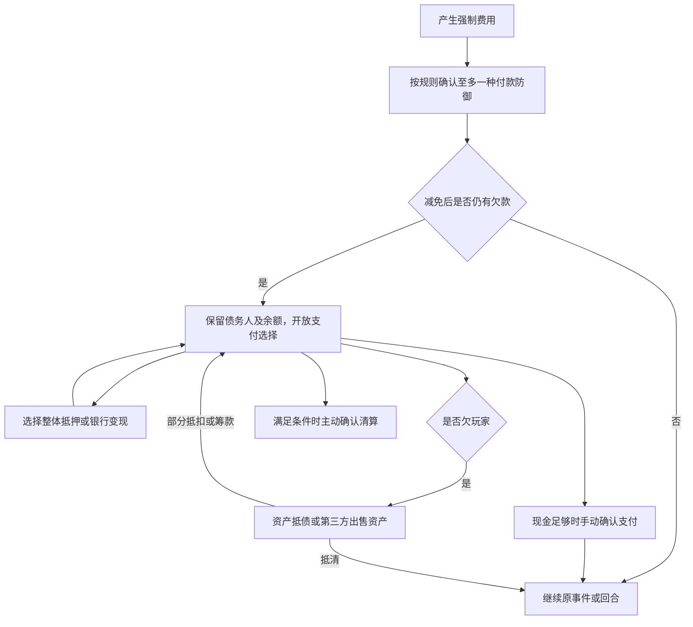

# 大富翁玩法内容设计：事件、财富与道具卡

名称、梗、台词、故事与插画的统一写法见 [卡牌设计准则](card-art-generation.md)。当前卡名直接突出梗本身，作品和人物出处保留在内容源表及故事中。

> 2026-10-15 抽取规则修订：按影响等级先抽 R 40%／SR 30%／SSR 25%／UR 5%，再等概率抽同档完整效果和匹配卡面；UR 在三个池均包含大成功／大失败。2026-10-13 评审的其他玩法沿用。本文记录已确认的玩法及源码实现状态，取代旧稿中相互冲突的建议。
> 当前代码能力见 [规则 DSL](game-rules-dsl.md)，地区与金额配置见 [配置指南](game-configuration.md)，四人局节奏见 [数学模型](game-economy-model.md)。策划确认不等于运行验收。

## 1. 目标与实施状态

以四人线下讨论、每次正常行动约 45–60 秒为主要场景。目标是避免突然破产，保留资产谈判与追赶空间，同时保证领先玩家的租金、产权和债权仍有价值。胜利条件保持最后一位未破产玩家获胜，不增加轮数结算，也不设置操作、偿债或交易倒计时。

| 内容 | 当前状态 |
| --- | --- |
| 强制费用先选择、整体抵押、玩家资产抵债及部分抵扣、第三方卖资产筹款 | 已接入代码；多人协商、断线和重启组合仍需实际对局验收 |
| 房间小／中／大地图设置、地区地名池、统一金额倍率及逐项固定覆盖 | 已接入代码；地图由房主在大厅设置 |
| 五档地价与新局 25% 基础租金 | 已接入代码；本局比例随快照保存，已有对局沿用保存比例，旧同格式快照缺失比例时保留 10% |
| 全员可见净资产数值与名次 | 本轮已接入代码 |
| 机会、财富、卡牌与回合四份行为配置 | 已接入分层内容目录；原小池 DSL 留作旧手牌和已排队效果兼容，不参与新事件抽取 |
| 机制／金额档／完整参数／皮肤抽取、排名目标、付款减免、免费升级、主动负位移、赌博等 | 已接入后端与界面，沿用同事务效果队列和等待任务；联机恢复组合未验收 |
| 123 条机会、112 条财富、113 张卡牌 | 共 348 张卡面，财富 12 张再次行动停用，启用 336 张；三个池均启用 UR |

地区当前仅生成地名和公开元数据，不按地区筛选事件、改变价格或赋予专属技能。后续有明确地区事件需求时再设计。

## 2. 地图与经济基线

地图大小是房间设置，房主在开局前选择小／中／大，分别使用 `16 + 人数 × 4／6／8`，默认大地图，再开沿用房间选择；进行中不改棋盘。机会与财富数量只按人数确定，不随大小变化。每边优先使用一个地区组的地名，不足时从其他地区补齐，整张地图的地产地名不得重复。新局四角为起点、两个轮换活动角、监狱（见[活动说明](corner-activities.md)），机会和财富总数保持并移到边上；补充特殊格之间至少隔一个普通格。

| 人数 | 小 | 中 | 大 | 机会 | 财富 |
| --- | --- | --- | --- | --- | --- |
| 2 | 24 | 28 | 32 | 2 | 2 |
| 3 | 28 | 34 | 40 | 2 | 2 |
| 4 | 32 | 40 | 48 | 3 | 3 |
| 5 | 36 | 46 | 56 | 3 | 3 |
| 6 | 40 | 52 | 64 | 3 | 3 |

3／5 人的中地图采用 9/8/9/8、12/11/12/11 格长短边组成矩形闭环，不把格数四舍五入到其他值。新局地产数量为总格数减去机会、财富、起点、监狱与两个活动角；大小不自动改变金额或事件机制比例。

金额使用“基准 × 统一倍率，逐项可用最终固定金额覆盖”。新局默认倍率为 2；倍率不作用于步数、概率、比例、手牌数量或交易双方手动输入的金额。建造和租金由已经放大后的实际地价计算，避免重复乘倍率。

| 项目 | 基准 | 默认新局 |
| --- | --- | --- |
| 每人初始现金（2 人） | 6000 | 12000 |
| 每人初始现金（3～4 人） | 6000 | 12000 |
| 每人初始现金（5～6 人） | 7500 | 15000 |
| 向前或后退经过、到达起点或原地停留 | 1000 | 2000 |
| 地价五档 | 400 / 600 / 800 / 1200 / 1600 | 800 / 1200 / 1600 / 2400 / 3200 |
| 每人初始手牌 | 2 人 2 张，3 人及以上 3 张 | 不乘倍率 |
| 每次向前或后退经过、到达起点或原地停留补给 | 2 人 1 张，3 人及以上 2 张 | 不乘倍率；按本局人数，含已淘汰玩家 |
| 建筑上限 | 3 级 | 3 级 |
| 每级建造 | 实际地价的 50% | 400 / 600 / 800 / 1200 / 1600 |
| 出售一级建筑 | 实际建造成本的 50% | 200 / 300 / 400 / 600 / 800 |
| 整体抵押 | 当前土地及建筑成本估值的 50% | 保留建筑、停止收租 |
| 赎回 | 抵押时固定估值的 55% | 不随拆房或转让重算 |

每边五档地价尽量均衡分配；先打乱价档顺序，不足完整五档的一组随机取剩余价档，再打乱地块价格位置。短边不足五块时不保证包含全部五档，也不固定优先低价档。已生成地图保持原价格与位置。

新局基础租金为实际地价的 25%，等级倍率沿用 `[1, 3, 6, 10]`，等级从 0 开始，因此各级对应地价的 25%／75%／150%／250%。基础比例保存在本局 `rentBasePercent`；已有对局沿用其保存比例，缺失字段的已有同格式快照保留原 10%，固定租金覆盖优先。默认新局租金如下：

| 实际地价 | 0 级 | 1 级 | 2 级 | 3 级 |
| --- | --- | --- | --- | --- |
| 800 | 200 | 600 | 1200 | 2000 |
| 1200 | 300 | 900 | 1800 | 3000 |
| 1600 | 400 | 1200 | 2400 | 4000 |
| 2400 | 600 | 1800 | 3600 | 6000 |
| 3200 | 800 | 2400 | 4800 | 8000 |

当前付费建造仍要求停在自己的未抵押地产，每回合该地最多升一级，新买地产不立即升级。免费升级使用独立选择窗口，成功后也计入本回合该地产的升级次数。统一 ×2 只改变币值，不改变资产收益率或理论决胜速度。

基础租金本轮由上轮确认的 50% 调整为 25%；最高档三级默认租金为 8000，触发“下次付租翻倍”后为 16000。仍先处理付款防御和资产协商，不因一笔现金不足自动清算；此前 10% 基础租金的模型不能用于推断本轮局长或淘汰节奏，本轮没有恢复数学模型计算。

## 3. 强制费用与资产结算

所有正数强制费用先开放支付选择，即使现金足够也不能直接扣钱。主动买地、建造、赎回和自愿赌博仍按各自现金校验，不生成强制偿债窗口。

费用复用 `rent` / `debt` 待选及现有回合游标，不重排公共回合阶段。落点、事件组合或全体扣款遇到支付等待即暂停，完成后继续原位置；全体扣款逐人处理，整批完成后才判胜。



- 系统费用：玩家自行选择地产向银行整体抵押或整套出售筹款，不与银行协商资产抵债，也不在系统费用窗口发起玩家交易；筹款后仍需确认现金支付。须先自行抵押或出售全部可抵押地产；现金加最高银行变现所得仍不足时才可确认清算。
- 玩家费用：向债权人提供至少一块地产，双方协商抵扣金额，可以全部抵清或部分抵扣。金额不超过当前债务余额，没有银行估价上限；战略价值由双方判断。抵扣部分无需双方先转现金。也可以向第三人卖资产筹款，再支付原债权人。
- 主动交易通常由当前行动者在掷骰前或资产管理阶段发起；玩家债务的付款人可在偿债窗口发起。暂时保留偿债窗口内普通交易的现有边界，因此罚款或收费可能间接开启一次交易机会，不另加禁止规则。
- 报价绑定当前债务；接受时复核产权、现金、债权人及余额，资产和债务同一次提交变更。拒绝或取消返回原费用；未接受报价不会减免债务。所有报价不限时，相关玩家离线则保留等待。
- 银行整体抵押基数 `mortgageBase` 保存土地加当时建筑成本。以默认地价 3200、三级建筑为例，整体估值 8000、抵押得 4000、赎回需 4400。建筑保留但不能升级或单独出售；灾害毁房仍按原基数赎回，转让时基数随产权移动。
- 系统整套回收土地和现有建筑，默认按当前成本估值的 70% 结算，无需先逐级卖房；已抵押时扣除固定赎回费用，回收款不足须用现金补差价，现金不足不能出售。出售后产权归还银行、建筑归零；原 `sellLand.<实际地价>` 覆盖继续作用于土地部分。估值 2000 时直接出售得 1400；先抵押得 1000 再出售，扣固定赎回费 1100 后额外到账 300，总额 1300，低于直接出售。
- 银行可变现能力取各地产抵押、整售或先卖房再变现的最高所得；已抵押地产只计扣除固定赎回费用后的正净额，不强迫补足负权益地产。前后端清算判断、清算偿付和机器人筹款使用一致口径。
- 清算把地产交回银行、建筑归零、手牌作废，可变现金额向玩家债权人偿还至多欠款。能通过银行变现偿清时不得直接申请破产；不新增跨回合借条、玩家借贷或债务利息。

流程图中的通用付款防御已接入源码，包括自动免单、免租及减半；本轮尚未进行实际联机验收。

## 4. 净资产榜与排名目标

所有玩家与观众看到相同的净资产具体数值和名次；已破产玩家不参与排名。

```text
当前地产成本估值 = 地价 + 当前等级 × 本局每级建筑成本
未抵押地产权益 = 当前地产成本估值
已抵押地产权益 = max(0, 当前地产成本估值 - 固定赎回费用)
净资产 = 现金 + 所有持有地产的权益之和
```

抵押收到的现金已经进入现金余额，所以必须扣银行赎回费用，不能再次完整计入房产。毁房后权益可能降至零，抵押基数仍固定。

展示名次采用并列名次，例如 1、1、3、4。需要“首富一人”或“榜底一人”的事件，则在事件开始时从并列候选中随机选一人，并将结果保存、公开说明；重连和重启不能重新抽人。不按座位固定针对玩家。展示已实现，排名目标解析和保存仍待接入事件引擎。

## 5. 抽取与内容组织

内容按实际影响分为 R／SR／SSR／UR，三个普通随机池均先按 40%／30%／25%／5% 抽等级，再等概率选择该档去重后的完整效果参数，最后等概率选择匹配卡面。等级作用于玩法影响，不再仅是卡面皮肤权重；收益和惩罚都可进入高档。

| 等级 | 概率 | 影响口径 |
| --- | --- | --- |
| R | 40% | 单人小额收支、普通单卡补给 |
| SR | 30% | 中额收支、落点位移或加码、单次控制和部分防御、普通赌博 |
| SSR | 25% | 大额收支、建筑与强力状态、多人或指定排名目标影响 |
| UR | 5% | 极端收益与损失，三个池均有大成功／大失败结果 |

同效果卡面的等级统一；原固定步数和同数值前进卡合并为一个实际移动效果。等级中的卡面数量不改变该效果概率，组织分组也不参与抽取。三个随机池的实际效果清单、参数阈值、定向补给例外、UR 数值及推导概率以 [内容运行说明](game-content-runtime.md) 为准。

当前卡面共 348 张：机会 123、财富 112、道具 113；财富再次行动的 12 张继续停用。此次只增加 6 张 UR 卡面，其他素材身份、参数、文案和插画保留；原卡面等级重新按效果分配，不沿用旧皮肤档位。

UR 机会与财富分别增加基准 +3000 和 3000 银行费用，两种效果在各自 UR 档内等概率。UR 道具使用可取消的风险窗口，确认后基准下注 2000，50% 中奖发放奖金 6000、不另返本金；净结果为 +4000 或 −2000，按本局经济配置换算。取消或现金不足时保留卡与主动次数，确认后的结果随事务保存；已有命令去重负责提交一致性。

普通事件位移归 SR，因为会继续结算落点并可能连锁抽取事件；其概率由同档效果数决定。定向补给保持指定牌型，只在该类型存在的等级中归一化抽取，不能为补足四档而换成其他牌型。当前三种指定类型均为 SSR。

### 5.1 卡面文案与影响等级（2026-10-15 修订）

机会事件、财富事件和道具卡继续共用“名称与等级、台词、场景描述、实际效果”的卡面结构，道具另标主动／防御／持续／即时。R／SR／SSR／UR 代表实际影响档，不再作为皮肤权重；UR 使用暖红金色标识，新增卡面未生成独立插画时复用原通用图集。

- **台词**：写成玩家在现场会喊的话，或熟悉角色会说的短句，用开黑、出货、红温、甩锅、求救等反应带出笑点；不用宣传语、对仗金句或规则解说。优先保留用户提供的原句，同一梗可有固定口头禅，不为追求全库不重复而改坏梗。例：拿到非洲之星喊“兄弟们我先撤了”，被抢走喊“下次再架二员我就是狗！”。
- **描述**：直接带玩家进入熟悉的游戏或生活场景，让梗自然成立。例如“呀哈哈”的描述为“恭喜你找到了一个呀哈哈，还剩899个～”。笑点可以夸张，能力不能夸大。任意门只有卡面规定格数，换位只换站位，飞行不免落点费用，复活甲不救破产，免付款不免主动购买。
- **效果**：保留原模板与基准数值，实际卡面必须按本局倍率及固定覆盖展示最终金额，不能把基准当成实际到账金额。抢夺按第 7 章由服务端随机转移一张手牌，皮肤不能暗示查看或自选对方的手牌。
- **中控双事件**：“落地中控”拿到非洲之星，沿用基准现金 2000，台词为“兄弟们我先撤了”；原“手速太慢”素材改为“非洲之心被抢走”（`delta_star_stolen`），台词为“下次再架二员我就是狗！”，效果为休息 1 回合（用户称“硬控 1 回合”），不是监禁状态。两张均为机会素材，原机制与素材总数不变。
- **出处**：用来标注题材参考；台词与描述均为二次创作，允许混梗，不标为角色说过的原句。
- **停用内容**：财富中的 12 条再次行动素材继续标为首版停用，不因新增台词或稀有度重新进入首版抽取；本轮新增 UR 已进入运行池。

## 6. 财富与机会的确认规则

财富以现金回血为主，首版不产出“立即再次行动”。抽卡、升级和免付款可以保留为少量收益，但皮肤数量不能让非现金收益变成主要结果。

| 机制 | 已确认结算 |
| --- | --- |
| 财富现金 | 给落格者，金额走统一倍率或固定覆盖 |
| 财富弱者补助 | 落格者先得基础现金，事件开始时锁定的榜底玩家再得额外补助，可为另一人；基础现金确认基准 400（默认 800），额外补助沿用条目中的基准 600／800，分开配置 |
| 免费升级事件 | 玩家选择自己未抵押、未满级、本回合未升级的地产，升一级；有合法目标时允许放弃但不给替代现金，只有确实无合法目标时给基准 400（默认 800）现金 |
| 免除下次付款 | 保留到下一笔强制费用，自动触发并消耗；重复获得不增加次数 |
| 首富税费 | 不同事件采用各自金额，不统一为 500；仍由配置给出金额 |
| 自愿赌博 | 允许参加或放弃，只用现有现金下注，付清后开奖；不抵押筹款下注、不先清算再开奖 |
| 自己地产建筑全毁 | 自行选择一块有建筑的地产，全毁；无合法目标直接结束；与随机全图灾害同样有 30% 概率赔偿 50% 损失 |
| 下次付租翻倍 | 下一次实际需付的租金翻倍，触发后消耗；重复获得不叠加 |
| 全体扣款 | 对每个付款人先开放选择，顺序等待；整批结束才判胜 |

“下次付租翻倍”先形成应付租金，再按付款防御规则减免；减免后不向房东补差。“本回合租金翻倍”旧表述作废，不能挂在当前行动后续而导致永远没有使用机会。龙卷风使用随机全图地块灾害，自选自家受损事件使用本人选地窗口。两者都按实际损毁等级乘本局建造成本计算损失，30% 概率赔 50%；没毁掉建筑不发补偿。抵押地产同样可受损，补偿不改变固定赎回费用。正租金先触发并消耗翻倍，再减免；即使被全免，翻倍状态也已消耗。原本租金为零的落点不触发。

### 6.1 财富与机会的新抽取规则

两种事件格分别从自身池中按 R 40%／SR 30%／SSR 25%／UR 5% 抽等级；旧财富现金 60%、机会移动各 8%、金额档 70/25/5 和 80/19/1 均已废止。抽中等级后在该档全部完整效果中等概率选择，不再先选机制或金额档。

财富仍停用再次行动，新增 UR 银行费用后不再保证踩财富格只有收益。机会、财富各自 UR 的大额奖励和银行费用各占该普通池 2.5%。具体效果数和移动概率见 [内容运行说明](game-content-runtime.md#抽取顺序与概率)。

## 7. 道具卡的确认规则

首版以 111 张库的 12 类模板为准，原主稿中的“指定传送到无主地产、每局唯一”传送门暂缓。名为任意门的皮肤若属于“替代掷骰 5 格”，仍只移动 5 格，不因此拥有地图任意指定能力。新增遥控骰子属于替代掷骰模板下的独立参数类型，允许使用者自选 1～6 点；固定步数皮肤仍按卡面定义移动，不能因此获得自选点数能力。

| 模板 | 使用和目标规则 |
| --- | --- |
| 替代掷骰 | 固定 0–6 格按卡定义；遥控骰子另允许自选 1～6 点；均替代本次随机掷骰，移动并结算 |
| 路障 | 沿用原路障目标与触发规则 |
| 拆房 | 对手合法地产降一级，无退款 |
| 换位 | 沿用原换位合法目标与结算规则 |
| 免租 | 本次租金免除，房东收 0 |
| 主动前进／后退 N 格 | 替代本次掷骰，移动并结算后进入资产管理；不能 MOVE 后仍让玩家再掷骰 |
| 掷骰加码 | 掷骰前使用，占本回合一次主动出牌；骰子与加码合成一次连续移动，经过起点和路障照常处理，只结算最终落点；“持续”标签不免除主动次数限制 |
| 免费升级 | 目标资格与事件相同；确认前取消选地或无合法目标时卡保留，不消耗且不占主动次数；免费建筑按本局标准建造成本估值 |
| 付款减免 50% | 本笔强制费用结算前使用，减免额向下取整，剩余应付保留；房东只收减免后金额 |
| 解除监禁 | 在被施加监禁／休息时选择使用或放弃，不占主动次数；解除对应状态，不补走已经跳过的回合；需新增响应窗口 |
| 抢夺手牌 | 玩家选一名未破产的对手，由服务端从目标手牌随机转移 1 张；双方只看到这张牌，不查看其余手牌；目标没牌时保留抢夺卡且不占主动次数，不改成罚款 |
| 即时现金 | 主动使用获得配置现金，仍计主动次数 |

开局两张，每回合最多一张主动卡。手牌上限确认六张；超限时由本人从原有与新获得的牌中选择保留六张，其余逐张按基准 200（默认 400）折现，不能按抽取顺序自动替玩家弃牌，也不能整批只给一次折现；选择窗口、手牌上限与折现尚待实现。

### 7.1 道具的新抽取规则

普通道具先按 R 40%／SR 30%／SSR 25%／UR 5% 选等级，再等概率选同档完整效果，最后等概率选卡面；原固定步数 14%、遥控 4% 等机制概率及皮肤 6/3/1 权重均已废止。同格数的固定移动和前进合并，避免同义效果重复增加出货率。UR 风险道具复用 `gamble` 窗口，确认下注才消费卡和主动次数；未确认取消保留。


### 7.2 道具内部参数概率（本轮确认，待实现）

| 机制分支 | 去重后的合法参数 | 参数抽取 |
| --- | --- | --- |
| 固定替代掷骰（总卡池 14%） | 0／2／3／4／5／6 格 | 六档等概率 |
| 遥控骰子（总卡池 4%） | 使用时由玩家自选 1～6 点 | 发牌时不随机固定点数 |
| 主动位移（总卡池 10%） | −3／−2／+2／+3／+4 格 | 五档等概率 |
| 掷骰加码（总卡池 6%） | +1／+2／+3 格 | 三档等概率 |
| 即时现金（总卡池 4%） | 基准 300／500／800 | 三档等概率；到账再按本局金额换算 |

先抽机制及完整参数组合，再在匹配皮肤内按 6／3／1 加权；两个同参数皮肤不能使该参数概率翻倍。固定步数卡目前没有 1 格皮肤，1 点选择由遥控骰子覆盖，不凭空新增参数或改变原 111 张素材效果。

### 7.3 手牌超限选择（本轮确认，待实现）

一次补给结算后手牌不超过六张时直接继续；超过六张时，候选包含本人原有手牌和本次全部新牌，由本人选留恰好六张，其余每张基准 200 折现。不能额外多弃牌以兑换更多现金，也不由系统自动决定保留旧牌或新牌。

已保存的同格式手牌若超过六张，同样由本人选留；恢复时不自动删除或折现。已有费用／交易等待点保留，超限选择不得覆盖其进度。候选牌 ID、具体皮肤、已抽取结果及父效果返回位置保存，等待期间不继续后续结算；确认后同一次提交保存选留、弃牌与折现金额，重连或重启不重新抽牌、不重复折现。候选及选择结果仅本人可见，公开记录不展示牌型、数量或具体补给卡面。

### 7.4 选择窗口与恢复顺序

下表落实已确认玩法的执行要求，已接入待选与恢复数据结构；不改变公共回合阶段顺序，也不增加选择倒计时。

| 选择 | 操作人及入口 | 确认后的返回位置 |
| --- | --- | --- |
| 解控响应 | 实际被施加监禁／休息者选择使用或放弃；不占主动次数 | 解除对应状态或保留状态，继续父效果，不新增移动、不补回合 |
| 免费升级 | 受益者选择自己未抵押、未满级、本回合未升级的地产；事件可放弃但不给现金，确实无目标才给基准 400；卡牌确认前取消或无目标保留 | 升一级并记录本回合该地已升级，或放弃后继续父效果；非法目标不消费卡牌 |
| 自家建筑全毁 | 落格者选择一块自己有建筑的地产；无目标结束 | 确认后保存实际建筑损失，先完成 30% 概率赔 50% 的补偿联动，再继续父效果 |
| 自愿赌博 | 落格者参加或放弃；只有已有现金足够才可参加，不在窗口内抵押筹款下注 | 先支付本局实际下注，再开奖并按条目奖金到账，继续父效果；开奖样本提交保存，不重复支付或开奖 |
| 手牌超限 | 手牌获得者按第 7.3 节私人选留 | 选留与逐张折现完成后继续原效果或原等待点 |

待选绑定实际操作人、已确定机制／参数／皮肤及返回游标；合法目标由服务端在确认时复核，不提前选择默认目标。相关玩家离线保留等待，重连继续同一选择。付款减免前的原始费用与防御结果也随费用保存，资产抵债后不能重新按剩余余额再减半。

### 7.5 免费升级交叉规则（已接入源码）

免费升级只免去本次支付的建设费用，所得建筑与普通建筑按本局每级标准建造成本计算价值，不把建筑成本记为零。净资产和整体抵押计入同样的建筑成本；出售一级默认返还标准建造成本的 50%，本局固定金额覆盖和抵押建筑不可单独出售等既有规则仍适用。灾害按标准建造成本乘实际损毁级数计算损失，免费建筑同样按既有 30% 概率补偿损失的 50%；普通拆房仍不退款、不触发灾害补偿。

机会与财富的免费升级事件，有合法目标时允许玩家放弃，放弃后继续父效果且不给替代现金；只有服务端确认确实没有合法目标时才给基准 400（默认 800）现金。免费升级卡在确认前取消选地，或没有合法目标时保留原卡，不消耗、不占主动次数，也不折成现金；选地确认成功后才消费卡牌并记录该地本回合已升级。以上选择和结果已进入同事务房间快照与流程等待点，实际停机恢复仍需环境验收。

## 8. 付款防御顺序

免付款状态与 50% 减免覆盖租金、罚款、税务、全体扣款等强制费用，不覆盖主动买地、建造、赎回、交易或自愿赌博。一笔费用最多一种付款防御，不能连续两次减半。已持有的“免除下次付款”先自动触发，消耗后本笔不再用另一种防御。

先确定减免后债务，再协商资产抵债或筹款。例：租金 3000，减半后欠 1500，房东收 1500；全免则欠 0，直接继续事件，无需点击现金支付；银行不补差。原免租卡也按房东收零处理。

奇数费用的减免额为 `floor(原费用 ÷ 2)`，应付为原费用减去减免额；例如 301 减免 150、仍付 151。租金翻倍先作用于原正租金，再进行本笔至多一种防御，随后锁定债务余额并进入资产协商。

## 9. 实现状态与后续数值评审

| 实现项 | 当前源码状态 |
| --- | --- |
| 机制／数值档／皮肤分层抽取 | 已按确认概率接入，具体机制／参数／皮肤结果随效果保存 |
| 排名目标与全员发奖 | 已在事件开始锁定随机并列目标，复用顺序效果结算 |
| 自愿赌博、免费升级、自选建筑全毁 | 已接入合法目标、可确认／放弃窗口和保存的返回位置 |
| 通用付款防御与下次付租翻倍 | 已接入一次性状态、消费时机与防御后偿债，选择事实随提交保存 |
| 道具库剩余模板与手牌上限 | 已接入确认概率、合并移动、私人选留六张、主动次数和非法目标不消耗 |
| 348 张内容卡面接入 | 原 342 张身份和效果参数保留，新增 6 张 UR 卡面；财富 12 张再次行动继续停用 |

机会与财富机制比例、普通现金金额档、财富抽卡拆分、榜底基础补助和灾害补偿已确认，见第 6 章。旧稿总权重 22／30 作废。三条定向补给类型已有明确素材；本轮已确认道具机制与内部参数概率、匹配皮肤组内权重、随机抢夺、加码／解控时机、玩家超限选留六张、减免取整、合并移动，以及免费建筑标准估值和免费升级的放弃／取消边界，并新增基准 200 机会和遥控骰子素材。上述基础策划规则已收口，并按内容抽取、选择恢复、机制、界面的顺序接入；2026-10-15 抽取部分改用四档完整效果等概率，旧机制及金额档权重作废；具体文件、金额键和协议见 [完整内容接入](game-content-runtime.md)。原有六种无皮肤手牌仍兼容使用；旧存档超限手牌由本人选留，旧版已开始筹款／协商的债务不重新开放按余额减免。

此前四人大地图（48 格）、三档地价与 10% 基础租金的简化模型不支持“通常两三个小时淘汰决胜”的结论。用户已暂停这轮数学计算；报告保留为此前大地图基线，不外推到小／中地图或新五档地价与 25% 基础租金，也未对本轮租金调整重算。领先优势与追赶空间应以实际对局中的净资产差、抵押率、首次出局时间及总局长一起评审，不能仅看现金期望。

## 10. 验证边界

地图设置修改使用跳过测试的后端编译、前端类型检查与差异静态核对；此前独立数值分析保留，不再续算。没有编写或执行单元／冒烟测试，没有前端 build，没有多人实际对局、运行数据库、部署或自动提交。数值分析不证明运行链路正确，也不能替代完整卡牌和自由交易的对局记录。

此前文案修订仅更新主稿与三份内容库，并提供讨论用卡面预览；以逐条结构、数量、标识、台词、描述及原效果对照作静态核对，没有改动运行规则或游戏界面，没有执行单元／冒烟测试、前端 build、运行接口验收或自动提交。

此前完整度续审在用户逐项确认后更新主稿与三份内容库，新增两条素材，原 340 条素材效果保留；仅进行文档结构、数量、ID、参数覆盖、概率合计与原条目对照的静态核对。运行配置仍为 9 种机会、6 种财富、6 种道具；当轮未执行编译、类型检查、单元／冒烟测试、前端 build、运行验收、数值模型续算或自动提交。

此前五档地价与 50% 基础租金修改已通过 `mvn -o -f backend/pom.xml -Dmaven.test.skip=true compile`、`npm run typecheck` 及差异静态检查；只编译到后端 classes，未重新打包 JAR 或重启服务。道具参数概率、私人选留六张、减免取整和加码合并移动仅完成策划确认，素材仍为 342 条，具体机制待接入。未编写或执行单元／冒烟测试，未执行前端 build、真实页面／API／数据库／恢复验收、数值模型续算或自动提交。

本轮默认基础租金由 50% 改为 25%，同步配置、前端常量、租金表和当前说明；免费建筑标准估值、事件可放弃但不领替代现金、卡牌确认前取消不消耗已确认并写入主稿和三份内容库，具体免费升级机制仍待接入。`mvn -o -f backend/pom.xml -Dmaven.test.skip=true compile` 与 `npm run typecheck` 通过，后端复制新配置资源，Java 类已是最新；差异及素材逐条对照静态检查通过，342 条素材保持不变。未编写或执行单元／冒烟测试，未执行前端 build、重新打包 JAR、服务重启、真实页面／API／数据库／恢复验收、数值模型续算或 Git 提交。

2026-10-13 完整内容实现：新增分层内容目录、已冻结卡面和参数、私人选择及返回位置；接入十二类道具与已确认机会／财富机制、付款防御、一次性状态、排名锁定和手牌选留。前端复用已有弹框，统一显示名称、稀有度、类型、台词、描述与本局实际效果。已执行跳过测试的后端编译、前端类型检查、素材与配置静态核对、按实际依赖执行配置加载校验及差异检查；未执行单元／冒烟测试、前端 build、服务重启、数据库或多人实际对局验收、数值模型续算、Git 提交或推送。源码完成不表示已在现有运行服务上线。
